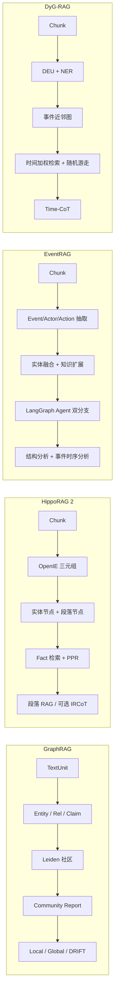

# GraphRAG / HippoRAG / EventRAG / DyG-RAG 对比

> 基于本地仓库源码与论文整理：`graphrag-main`、`HippoRAG-main`、`EventRAG-master`、`DyG-RAG-main`。  
> 日期：2026-08-29。重点对照**图谱结构**与**推理机制**，并覆盖索引、检索、存储与适用场景。

---

## 0. 一句话定位

| 系统 | 论文 / 出处 | 要解决的问题 | 图谱「主轴」是什么 |
|------|-------------|--------------|-------------------|
| **Microsoft GraphRAG** | Edge et al., 2024，[arxiv 2404.16130](https://arxiv.org/pdf/2404.16130) | 私有语料上「连点成线」与「全局主题理解」；朴素向量 RAG 答不了跨文档综合题 | **实体–关系图 + 社区层次摘要** |
| **HippoRAG 2** | Gutiérrez et al., NeurIPS 2024 / ICML 2025，[arxiv 2502.14802](https://arxiv.org/abs/2502.14802) | 把 RAG 做成类海马体长期记忆：多跳联想 + 复杂语境整合，且在线检索便宜 | **实体短语 + 段落的异构图**，用 Personalized PageRank 扩散 |
| **EventRAG** | Yang et al., ACL 2025，[anthology 2025.acl-long.830](https://aclanthology.org/2025.acl-long.830/) | 叙事文本里的事件、时序、因果、跨源合成；单次检索容易碎片化 | **事件知识图谱（EKG）**：Event / Actor / Action / Result / Tool |
| **DyG-RAG** | [arxiv 2507.13396](https://www.arxiv.org/abs/2507.13396) | 非结构化文本里的**时间知识**组织与时序问答 | **动态事件单元（DEU）构成的动态图 DyG**，边按共享实体 × 时间近邻 |

四套都是「先抽图、再检索、再生成」，但**图上什么是一等公民**完全不同：GraphRAG 是实体与社区，HippoRAG 是短语与段落，EventRAG 是带逻辑边的事件，DyG-RAG 是带时间戳的事件句。

---

## 1. 总览对照



| 维度 | GraphRAG | HippoRAG 2 | EventRAG | DyG-RAG |
|------|----------|------------|----------|---------|
| 代码血统 | Microsoft 官方流水线 | OSU-NLP 自研 | LightRAG 风格 + LangGraph Agent | nano-graphrag 改造 |
| 节点粒度 | 命名实体（可含 event 类型） | 短语实体 + 原文段落 | Event / Actor / Action / Result / Tool | 动态事件单元（一句一事一时） |
| 边语义 | LLM 描述的关系；可选 Claim | 事实共现、段落–实体、同义边 | NEXT STEP / REASON / DEPEND 等显式逻辑边 | `event_temporal_proximity`（共享实体 × 时间衰减） |
| 层次结构 | **有**：Leiden 多层社区 + 报告 | **无**层次摘要 | **无**社区；有 LLM 知识扩展 | **无**社区；图是事件近邻网 |
| 时间建模 | 弱；Claim 可带时间但默认关 | 基本不建模 | 作为事件属性 + Agent 解读时序 | **一等公民**：节点时间、向量时间编码、Time-CoT |
| 在线图算法 | 局部扇出；DRIFT 迭代追问 | **Personalized PageRank** | Agent 迭代查图，无经典图算法 | **加权随机游走** |
| 离线 LLM 成本 | 很高（抽实体 + 摘要 + 社区报告） | 中（OpenIE）；低于 GraphRAG | 高（抽取 + gleaning + kg-expansion） | 中高（DEU 抽取 + 可选 gleaning） |
| 在线延迟 | Global 很贵；Local 中等 | **低**（embedding + PPR） | Agent 多轮，高 | 中（向量 + rerank + walk + 一次 QA） |
| 典型评测 | 私有叙事语料的全局 / 局部问答 | NQ / PopQA / NarrativeQA / MuSiQue / 2Wiki / HotpotQA | UltraDomain、MultiHopRAG | TimeQA、TempReason、Complex-TR |
| 最擅长 | 语料级主题、跨文档综合 | 多跳事实联想、持续记忆 | 叙事因果链、多事件合成 | 时序 QA、任职/状态持续性 |

---

## 2. 各系统详解

### 2.1 Microsoft GraphRAG

**目标。** 朴素向量 RAG 有两类硬伤：一是答不了需要「跨多处线索拼起来」的问题；二是答不了「这份语料整体在讲什么」的主题题。GraphRAG 用 LLM 从文本抽出知识图，再做社区检测与自底向上摘要，查询时把这些结构塞进上下文。

**索引（默认 Standard 流程）。**

1. **TextUnit**：文档切块（默认约 1200 token），作为后续抽取与溯源单位。
2. **图抽取**：每个 TextUnit 抽 Entity（title / type / description）与 Relationship（source / target / description）。同名同类型实体、同端点关系会合并描述列表，再由 LLM 压成一条摘要。
3. **Claim（可选，默认关）**：抽带状态、可带时间界的断言，导出为 Covariate。
4. **图增强**：Hierarchical Leiden 社区检测，得到多层社区。
5. **社区摘要**：每个社区生成 Community Report（执行摘要 + 关键实体/关系），再做短摘要。
6. **向量化**：默认嵌入实体描述、TextUnit 文本、社区报告全文。

另有 **FastGraphRAG**：实体用 NLP 名词短语、关系用共现，省掉大部分抽取 LLM，社区报告仍用 LLM。适合偏全局综述、对实体保真度要求不高的场景；图更噪、更不宜单独当知识库用。

**知识模型（节点 / 边 / 层次）。**

```text
Document ──包含──► TextUnit
                      │
                      ├──抽取──► Entity  ←──Relationship──► Entity
                      ├──抽取──► Covariate（Claim，可选）
                      └──溯源

Entity ──隶属──► Community（多层）──生成──► Community Report
```

- **节点**：人、组织、地点、事件等；带类型与自然语言描述，不是严格 Schema。
- **边**：成对实体关系，带描述与强度；语义由 LLM 自由生成。
- **层次**：社区是 GraphRAG 真正区别于「平面 KG」的部分。上层社区 ≈ 全库主题，下层 ≈ 局部簇。
- **时间**：不是主结构。Claim 可时间约束，但默认关闭且通常要调 prompt 才有用。

**查询与推理。** 图本身不做符号推理；推理发生在 LLM 读结构化上下文时。四种模式：

| 模式 | 机制 | 适合的问题 |
|------|------|------------|
| **Local Search** | 用问题向量命中实体 → 扇出邻居、关系、covariate、相关社区报告、关联 TextUnit → 按 token 预算排序过滤 → 一次生成 | 「洋甘菊有什么药用？」这类**实体锚定**问题 |
| **Global Search** | 选定某一层社区报告 → map：每批报告产出带重要性评分的要点 → reduce：聚合高分要点生成终答 | 「这份语料最重要的五个主题是什么？」 |
| **DRIFT Search** | Primer：问题 vs top-K 社区报告，得到宽答案 + 追问；Follow-up：用 Local 细化；输出问答层次树 | 既要全局视野又要局部细节 |
| **Basic Search** | 标准 top-k 向量 RAG | 简单事实查找 |

**推理性质。** 归纳式、摘要驱动。Global / DRIFT 擅长「综合判断」，不擅长「某年某月谁在任」这类时间精确题。索引贵（图抽取约占索引成本 75%），日更语料上社区报告会滞后。

**仓库要点。** `packages/graphrag/` 是可配置流水线；存储默认 Parquet + 向量库；强调 prompt tuning。

---

### 2.2 HippoRAG 2（From RAG to Memory）

**目标。** 模仿海马体索引：新知识要能被**联想**（associativity / 多跳）和**整合**（sense-making），同时不牺牲简单事实记忆。HippoRAG 1 已用 PPR；HippoRAG 2 加强 OpenIE 事实层与 recognition memory，并强调持续学习、增量索引。

**索引。**

1. 文档预处理为 Chunk，分别嵌入。
2. **OpenIE**：LLM 抽 NER + `(subject, predicate, object)` 三元组。
3. 三套向量库：**chunk / entity / fact**。
4. 构图（igraph）：
   - **Fact 边**：同一三元组的头尾实体互连，权重按共现累计。
   - **段落–实体边**：段落节点连到该段出现的实体。
   - **同义边**：实体 embedding 做 KNN，相似度高于阈值则连边（对齐别名、近义说法）。

**知识模型。**

```text
Phrase Node (entity) ←──fact / synonymy──► Phrase Node
        ▲
        │ contains（权重 1.0）
        │
Passage Node (chunk)
```

- **节点两类**：短语（概念锚点）与段落（最终要返回的证据）。Fact 三元组主要进向量库，图上表现为实体–实体边，而不是独立的「关系节点」。
- **边三类**：抽取事实、段落归属、embedding 同义。无社区、无时间边、无因果类型。
- **设计意图**：图是**检索扩散器**，不是供人读的本体。PPR 把「查询相关的短语」的质量沿边传到相关段落。

**查询与推理（默认 `retrieve`）。**

1. 查询嵌入，与 **fact** 向量做相似度 → 候选三元组。
2. **Recognition Memory**：`DSPyFilter` 用 LLM 按问题过滤无关事实（类似「再认」）。
3. 用保留事实给图中短语节点赋 reset 概率；同时用稠密检索给段落节点一个较小先验（`passage_node_weight`，默认约 0.05）。
4. **Personalized PageRank**（无向、带权、damping 默认 0.5）→ 按段落节点的 PPR 分排序。
5. 若过滤后没有事实，回退纯 DPR。
6. QA：把 top 段落填进数据集对应的 RAG prompt，LLM 一次作答。

**可选 IRCoT。** `retrieve_ircot`：检索 → LLM 写一步 Thought → 用 Thought 再检索 → 合并文档分；直到出现 `So the answer is:` 或达到 `max_qa_steps`。这是**迭代检索**，不是图上符号推理。

**推理性质。** 联想式、检索主导。多跳靠「共享实体把段落连起来」+ PPR，而不是显式路径搜索。在线几乎不跑贵的图摘要。不建模时间，也不做全局主题综述（NarrativeQA 上的 sense-making 仍是「读检索到的长上下文」，不是社区报告）。

**仓库要点。** `src/hipporag/HippoRAG.py` 是主入口；向量库可换 Qdrant / Chroma / Milvus；支持增量 `index` 与 `delete`。

---

### 2.3 EventRAG

**目标。** 叙事文本里事件被扁平成句子后，跨文档指称不一致、时序丢失、多事件推理困难。EventRAG 建 **Event Knowledge Graph**，再用 Agent **迭代**查图，显式抓时序与逻辑依赖。评测在 UltraDomain、MultiHopRAG，强调生成质量、逻辑一致性、多跳准确率。

**索引。** 代码结构接近 LightRAG：

1. Chunk（默认 1200 token，重叠 100）。
2. LLM 抽取，默认类型：`Event, Actor, Action, Result, Tool`。关系要求标出序列 / 逻辑 / 依赖：
   - 序列：`NEXT STEP`
   - 逻辑：`REASON`
   - 依赖：`DEPEND`
   以及 Participates In、Uses Equipment 等参与/工具边。
3. **Gleaning**：漏抽则继续抽；再跑 **`kg-expansion`**：用 LLM 补上位类、下位例、前提、后果、共现概念（索引阶段把部分推理「预计算」进图）。
4. **实体融合**：新节点与库中向量相似度超过阈值则建 similar 关系并在后续构图中用融合表示，减轻跨文档重复。
5. 实体与关系分别进向量库；图存 NetworkX / Neo4j 等。

**知识模型。**

```text
Actor ──Participates In──► Event
Actor ──Uses──► Tool
Action ──NEXT STEP──► Action
Action ──REASON──► Action
Action ──DEPEND──► Action
Event ──因果/时序边──► Event
Result ←──产生── Event
```

- **节点**：事件是一等公民，但与 Actor / Action / Tool / Result **同层混合**，不是「事件图 + 实体图」分层。
- **边**：有较稳定的逻辑类型名，比 GraphRAG 的自由描述更利于时序/因果问答。
- **扩展节点**：可能来自 LLM 世界知识，不一定在原文中——增强连通性，也引入幻觉风险。
- **时间**：论文把时间标成事件属性、时序做成边；实现里主要靠 LLM 在边描述和 Agent 提示中解读，**没有 DyG-RAG 那种时间向量索引**。

**查询模式。**

| mode | 行为 |
|------|------|
| `local` | 抽 low-level 关键词 → 实体向量检索 → 邻居与原文 |
| `global` | 抽 high-level 关键词 → **关系**向量检索 |
| `hybrid` | 两者合并 |
| `naive` | 纯 chunk 向量 |
| **`agent`（默认、论文主推）** | 见下 |

**Agent 推理（`graph_agent.py` + `event_branch.py`）。** LangGraph 双分支并行：

```text
问题
  ├─ generate_keywords
  │     ├─ 结构分支：keywords_query → analyze → reflect ──(缺信息且未超轮)──► 再 query
  │     └─ 事件分支：event_graph_query（只保留 EVENT/ACTION 节点）
  │           → summarize（时序/因果）→ aggregate（时间线/因果链）
  │           → event_reflect ──(缺事件)──► 再 event_query
  └─ 两分支都就绪 → generate_final_answer（融合结构分析 + 事件分析）
```

- 结构分支：偏实体–关系表。
- 事件分支：过滤出 Event/Action，提示词要求总结 temporal / causal / actors。
- 反思：判断是否还要补关键词（事件侧限制 < 3 个）。
- 终答：显式要求整合「结构知识 + 事件知识」，并突出时序与因果。

**推理性质。** 规划–检索–反思的 **LLM Agent 推理**，不是 PageRank / 随机游走。多跳靠多轮工具调用。适合叙事合成；查询 LLM 次数多，延迟和费用都高于 HippoRAG。知识扩展会把模型先验写进图，态势场景里必须和「原文没有的不要补」对齐。

**仓库要点。** 实验用 Neo4j + Milvus、`gpt_4o_complete`；`QueryParam.mode` 还可写 `temporal/causal/participatory`，主路径是 `agent`。

---

### 2.4 DyG-RAG

**目标。** 第一套以**事件为中心的动态图 RAG**，专门组织文本里的时间知识。提出 **Dynamic Event Unit (DEU)** 粒度，并在检索后用 **Time-CoT** 做时序问答。评测三类时序 QA：TimeQA、TempReason、Complex-TR。实现基于 nano-graphrag。

**索引。**

1. Chunk（默认 1200 token，重叠 64）。
2. LLM 抽 DEU，约束包括：
   - 一句完整事实、明确主语、禁止代词；
   - 锚定到一个时间点或区间（ISO 粒度；相对时间用参考栈解析；不行则 `"static"`）；
   - 信息量过滤（主体 / 动作或任职 / 结果 / 时间）；
   - 不同日的事件必须拆开；区间取最早点（仅有结束点的 duration 用结束点）。
3. BERT-NER（`dslim/bert-base-NER`）抽 `entities_involved`。
4. 事件写入图节点，并进 **时间增强向量库**（`TimestampEnhancedVectorStorage`）。
5. **连边（无 LLM）**：仅在共享实体的事件对之间算分，每个事件最多 `max_links=6` 条：

\[
\text{score} = 0.75 \cdot \min(1,\; 0.3 \cdot |\text{共享实体}|) + 0.25 \cdot \text{时间衰减}(\Delta t)
\]

边类型固定为 `event_temporal_proximity`，无向。

**知识模型。**

```text
DEU 节点
  属性: sentence, context, timestamp, entities_involved, source_id
  边:   event_temporal_proximity (weight, time_distance, shared_entities)
        └── 连向共享实体且时间相近的其他 DEU

原文 Chunk 仅作溯源，不作为图节点
```

- **节点**：可检索的事件句，不是「Event 类型标签 + 槽位」。时间写在节点上。
- **边**：计算出来的近邻，不是 LLM 写的「导致 / 下一步」。图表达的是「同实体、时间近」，**不表达因果**。
- **无实体节点**：实体只是事件属性，用于连边和查询解析。
- **静态事件**：`timestamp=static` 的节点不参与近邻连边。

**查询（`dynamic_query`）。**

1. LLM 从问题抽 **time_constraints**（start/end）和 **entities**。
2. 用问题向量 + 起止时间做 `time_weighted_query`（默认 `time_weight=0.1`），各取大批候选后去重。
3. Cross-Encoder（默认 TinyBERT-L-2）或 BM25 + 实体匹配，选出 `et_top_k`（默认 20）**种子事件**。
4. 从多种子做加权随机游走：`walk_depth=2`，`walk_n=3`，每种子最多 `walk_nodes=5`，转移概率正比于近邻边权。
5. 游走事件按时间排序；按事件 `source_id` 频率取 top chunks。
6. **Time-CoT**：事件编成 `Event #i [时间]: 句子`，与 chunks 一起塞进 `dynamic_QA` prompt。

**Time-CoT 推理（prompt 层，非图算法）。** 明确要求：

- 问题类型：存在 / 持续 / 边界 / 聚合；
- 证据必须过时间窗；邻近时间只作背景；
- 状态持续性：未声明改变则默认延续；
- 任职：取查询时刻之前最近一次任命、且此前无终止；
- 区分瞬时事件、过程、转换；
- 证据不足时可做职业连续性等推断，但必须标明 inference。

消融可关时间线（`dynamic_QA_wo_timeline`），只留 chunks。

**推理性质。** **图上扩散（时间–实体近邻）+ LLM 时序逻辑**。因果不在边上，而在 Time-CoT。对「2000–2001 年间谁任 X」这类题比社区摘要方法直接得多。缺点：边是近邻不是因果；实体未对齐时「共享表面字符串」会错连；DEU 抽坏（代词、时间解析错）会污染全链路。

---

## 3. 图谱结构对比（核心）

### 3.1 什么是节点

| | GraphRAG | HippoRAG | EventRAG | DyG-RAG |
|--|----------|----------|----------|---------|
| 主节点 | 命名实体 | 短语实体 **和** 段落 | Event 与参与要素混合 | DEU（事件句） |
| 节点文本 | LLM 描述摘要 | 实体名 / 原文 chunk | 名称 + 描述 | 原句级 sentence + 短 context |
| 类型系统 | 可配，默认 organization/person/geo/event | 无类型，OpenIE 开放 | 固定五类 | 无事件类型；时间 + 实体列表 |
| 原文是否入图 | 不入图，经 TextUnit 关联 | **段落就是图节点** | 不入图，经 source_id | 不入图，经 source_id |

**结构含义。** HippoRAG 把「要返回的文档」直接放进图，PPR 的终点就是段落。其余三套图上主要是抽象对象，原文另存，查询时再拼回 chunk。

### 3.2 边从哪来、表示什么

| | 边的产生 | 边的语义 | 有向？ | 权重 |
|--|----------|----------|--------|------|
| GraphRAG | LLM 抽取 + 描述合并 | 自由自然语言关系 | 有向（源→目标） | 关系强度 |
| HippoRAG | OpenIE 共现 + 段落归属 + KNN | 「共同出现在一个事实里」/「这段提到它」/「叫法相近」 | 无向 | 共现次数或相似度 |
| EventRAG | LLM 抽取 + 知识扩展 | NEXT STEP / REASON / DEPEND / 参与 / 使用… | 有向 | relationship_strength |
| DyG-RAG | 算法：共享实体 ∩ 时间近 | 仅 temporal proximity | 无向 | 实体分 + 时间衰减 |

**谁在「发明」关系。** GraphRAG / EventRAG 的边是 LLM 写的，可能有因果，也可能幻觉。HippoRAG / DyG-RAG 的边更机械、更可复现：前者是共现与近义，后者是共享实体与时间距离。

### 3.3 层次、对齐、时间

| 能力 | GraphRAG | HippoRAG | EventRAG | DyG-RAG |
|------|----------|----------|----------|---------|
| 多粒度摘要 | Leiden 社区报告，多层 | 无 | 无社区；有 abstraction 扩展 | 无 |
| 跨文档对齐 | 同名同类型合并描述 | 同义 KNN 边（不合并节点） | 向量融合 + similar 边 | 无实体对齐；靠实体字符串重叠连事件 |
| 时间作为结构 | 弱（可选 Claim） | 无 | 属性 + 部分时序边，查询靠 LLM | **节点时间 + 时间向量 + 时间边权** |
| 因果作为结构 | 可能写在关系描述里 | 无 | **有 REASON / DEPEND** | 无；交给 Time-CoT |
| 溯源 | TextUnit / Document | 段落即证据 | chunk source_id | event.source_id → chunk |

### 3.4 结构示意（同一则新闻会变成什么）

以「2024-07-21 拜登宣布退选」为例：

```text
GraphRAG
  [Joe Biden:PERSON] --announced withdrawal--> [2024 Presidential Race:EVENT]
  再被 Leiden 并进「美国大选」社区，社区报告里写成一段综述

HippoRAG
  短语: Biden, presidential race, withdrawal
  段落: 该新闻 chunk
  边: Biden—withdrawal—race 的实体互连，以及 chunk—Biden

EventRAG
  Event: Biden Withdraws
  Actor: Joe Biden
  Action: Announce withdrawal
  边: Biden -Participates In-> Withdraws
      Debates -REASON/Cause-> Withdraws
      Withdraws -NEXT STEP-> Harris Succeeds   （扩展阶段可能补出）

DyG-RAG
  DEU: "Joe Biden announced his withdrawal from the presidential race on 21 July 2024."
  timestamp: 2024-07-21
  entities_involved: [Joe Biden, ...]
  边: 连到共享 Biden 且日期接近的其他 DEU（辩论、Harris 接任等），类型全是 proximity
```

---

## 4. 推理对比（核心）

这里的「推理」分三层：**图上传播**（算法）、**检索规划**（多跳怎么走）、**生成时逻辑**（LLM prompt）。

### 4.1 图上发生了什么

| | 图算法 | 种子怎么来 | 扩散依据 | 终点 |
|--|--------|------------|----------|------|
| GraphRAG Local | 1 跳扇出 + 排序 | 实体描述向量 | 图邻接 + 社区映射 | 混合上下文（实体/关系/报告/原文） |
| GraphRAG Global | 无遍历 | 整层社区报告 | 无；map-reduce 读摘要 | 综合答案 |
| GraphRAG DRIFT | 迭代 Local | 社区报告 Primer | 追问置信度 | 问答树再汇总 |
| HippoRAG | **PPR 全图扩散** | 过滤后的 fact 短语 + 弱 DPR | 边权（共现/同义/段落） | **段落排序** |
| EventRAG | 无经典图算法 | 关键词 / Event 向量 | Agent 决定下一组关键词 | 表格式上下文 + 事件小结 |
| DyG-RAG | **加权随机游走** | 时间加权向量 + CE rerank | proximity 边权 | 事件列表 + 高频来源 chunk |

HippoRAG 的 PPR 是**全局、确定性、一次完成**的关联检索。DyG-RAG 的随机游走是**局部、随机、有深度上限**的邻域扩展。GraphRAG Local 几乎不「走」图，只取种子的邻域。EventRAG 把走图交给 LLM。

### 4.2 多跳如何实现

```text
GraphRAG     预计算社区（离线多跳压缩） + 在线扇出 / DRIFT 追问
HippoRAG     共享实体把不同段落连上，PPR 一次跳多跳；可选 IRCoT 用自然语言再检索
EventRAG     Agent 多轮：反思缺什么 → 新关键词 → 再查 EKG（显式多事件链）
DyG-RAG      种子事件沿「同实体、时间近」走 1–2 步，再在 Time-CoT 里做持续性/任职逻辑
```

| 多跳类型 | 更合适的系统 | 原因 |
|----------|--------------|------|
| 实体桥接（A 的配偶的学校） | HippoRAG | 事实三元组 + PPR 就是为这个设计的 |
| 主题综合（全书主题） | GraphRAG Global | 社区报告是预计算的全局视图 |
| 因果链 / 步骤序列 | EventRAG | NEXT STEP / REASON 边 + Agent 聚合 |
| 时间线 / 任职 / 区间内状态 | DyG-RAG | 时间索引 + 持续性 prompt |
| 宽问 + 深挖 | GraphRAG DRIFT 或 EventRAG Agent | 都有「先宽后窄」的迭代 |

### 4.3 生成阶段的推理负担

| | 上下文长什么样 | LLM 被要求做什么 | 风险 |
|--|----------------|------------------|------|
| GraphRAG | 表格化实体/关系/社区报告 | 综合、评级、写报告 | 摘要丢失细节；Global 贵 |
| HippoRAG | Wikipedia 风格段落拼接 | 读段落直接答（可带 Thought） | 段落对了就能答；图不参与生成 |
| EventRAG | 结构表 + 事件分析文本 | 融合两路、强调时序因果 | Agent 幻觉；扩展知识无原文 |
| DyG-RAG | 按时间排列的 Event #i + chunks | 时间窗过滤、持续性、任职规则 | prompt 再长也可能用错时间的证据 |

**谁在推理。** HippoRAG 把大部分「关联」放在 PPR，生成最轻。DyG-RAG 把「关联」放在游走，把「时序逻辑」放在 prompt。EventRAG 和 GraphRAG Global/DRIFT 把更多推理交给多轮 LLM。

### 4.4 推理控制与可追溯

| | 中间过程可否检查 | 能否强制「只根据证据」 | 时间约束 |
|--|------------------|------------------------|----------|
| GraphRAG | 可看命中实体、报告、TextUnit | 有 groundedness 设计，Global 仍偏综合 | 弱 |
| HippoRAG | 可看过滤前后的 facts、PPR 段落分 | QA 仍可能不按段落编造 | 无 |
| EventRAG | Agent state：关键词、反思、事件小结 | 终答融合两路，约束弱于「只引用 event_id」 | 中（靠提示） |
| DyG-RAG | 种子、游走事件、Time-CoT 列表 | prompt 强调时间窗；仍是生成式 | **强（索引 + 提示双约束）** |

---

## 5. 索引、检索、存储与成本

### 5.1 离线 vs 在线

| | 离线重活 | 在线重活 | 增量 |
|--|----------|----------|------|
| GraphRAG | 抽图 + Leiden + 全量社区报告 | Local 一次 LLM；Global/DRIFT 多次 | 改图后社区报告宜重跑，日更成本高 |
| HippoRAG | OpenIE + 三套 embedding + 构图 | embedding + 一次 LLM 滤事实 + PPR | 支持增量 index / delete，同义边只算新节点 |
| EventRAG | 抽取 + gleaning + expansion + 融合 | Agent 多轮 LLM + 多次向量查询 | 可 insert；扩展使图持续变肥 |
| DyG-RAG | DEU 抽取 + NER + 近邻连边 | 时间向量 + CE + 游走 + 一次 QA | 可 insert；近邻边是局部计算 |

### 5.2 存储

| | 图 | 向量 | KV / 原文 |
|--|----|------|-----------|
| GraphRAG | 输出表（Entity/Relationship/Community…），默认 Parquet | 实体描述、TextUnit、社区报告 | Documents / TextUnits |
| HippoRAG | igraph pickle | chunk / entity / fact（Parquet 或 Qdrant/Chroma/Milvus） | OpenIE JSON |
| EventRAG | NetworkX / Neo4j / Oracle | 实体 + 关系（Nano / Milvus / Chroma…） | JsonKV / Mongo / Oracle |
| DyG-RAG | NetworkX / Neo4j | 时间增强事件向量 + Nano | JsonKV（docs/chunks/cache） |

### 5.3 相对成本（量级）

```text
索引 LLM 费用：  GraphRAG Standard  >  EventRAG  ≳  DyG-RAG  >  HippoRAG  >  FastGraphRAG
查询 LLM 费用：  EventRAG Agent ≈ GraphRAG Global/DRIFT  >  GraphRAG Local ≈ DyG-RAG  >  HippoRAG
查询延迟：       同上；HippoRAG 在线路径最短
```

HippoRAG 论文明确对比：在线省，离线索引也明显低于 GraphRAG / RAPTOR / LightRAG。GraphRAG 官方警告索引很贵，应先小样本调 prompt。

---

## 6. 评测与擅长的问题形态

| 系统 | 评测重心 | 典型问题 | 相对短板 |
|------|----------|----------|----------|
| GraphRAG | 私有语料理解、主题、跨文档综合 | 「语料中草药的核心价值是什么？」 | 精确时间、细粒度事实、日更 |
| HippoRAG | 事实记忆、多跳、NarrativeQA sense-making | 「X 的创始人毕业于哪所大学？」 | 时间线、因果叙事、全局主题 |
| EventRAG | 叙事生成质量、逻辑一致性、MultiHopRAG | 「辩论之后发生了什么、如何导致退选？」 | 严格时间窗、低幻觉约束、费用 |
| DyG-RAG | 时序 QA 三类数据集 | 「2000–2001 年谁担任该职务？」 | 非时间问题、主题综述、因果标签 |

四套评测集几乎不重叠，**不能直接比分数**。选型应按问题形态，而不是「谁更新」。

---

## 7. 实现血统与可组合性

```text
Microsoft GraphRAG     独立重量级产品（CLI / 配置 / 多种搜索）
nano-graphrag          轻量 GraphRAG 再实现
        └── DyG-RAG    换成 DEU + 动态图 + Time-CoT
LightRAG 风格
        └── EventRAG   换成事件类型 + kg-expansion + LangGraph Agent
HippoRAG               独立；图只为 PPR 服务
```

因此：DyG-RAG 与 EventRAG 都「看起来像 GraphRAG」，但 DyG 把**实体图换成事件近邻图**，EventRAG 把**查询换成 Agent，并把实体类型改成事件框架**。HippoRAG 与它们不是同一条演进线。

可组合（概念上，不是现成插件）：

- GraphRAG 社区报告 **+** DyG 事件层：周报用社区，日更事实用 DEU。
- HippoRAG PPR **+** 事件节点：若要把「多跳段落」做成事件锚点，需把段落节点改成 DEU。
- EventRAG 的 NEXT STEP/REASON **不要**和 DyG 的 proximity 混成一种边：一个是 LLM 因果，一个是算法近邻。

---

## 8. 如何选择

| 需求 | 更优先 |
|------|--------|
| 私有文档库的主题、全局报告、调查分析 | GraphRAG（Global / DRIFT）；实体质量要求高用 Standard，只要综述可用 Fast |
| 多跳 QA、FAQ、持续写入新文档、在线要快 | HippoRAG 2 |
| 故事、流程、实验步骤、新闻因果链 | EventRAG Agent |
| 时间敏感 QA、时间线、任职与状态是否延续 | DyG-RAG |
| 日更、要溯源、不能把模型常识写进图 | 不要单独用 EventRAG 的 kg-expansion，也不要把 GraphRAG 社区报告当事实库 |

**反模式。**

- 用 GraphRAG 社区报告当「今天发生了什么」的主库：摘要会抹掉时间和出处。
- 用 HippoRAG 当态势主轴：PPR 擅长联想段落，不擅长按时间窗切事件。
- 用 EventRAG 扩展边当已核实因果：扩展来自 LLM 先验。
- 用 DyG 近邻边当「导致」：共享实体 + 时间近 ≠ 因果。

---

## 9. 对「事件为中心的应用图谱」的启示

若目标是新闻/态势类系统（事件层主轴、实体层挂槽位、原文层溯源），四套对应关系大致是：

| 能力 | 可直接借鉴 | 不宜原样照搬 |
|------|------------|----------------|
| 一句一事一时 | DyG-RAG 的 DEU 抽取与时间解析栈 | 不要停在开放 sentence，还要类型/地点/行为体槽位 |
| 时间窗检索 | DyG 的 query 解析 + 时间加权向量 | 仅靠 Time-CoT 不够，查询层最好先符号过滤时间 |
| 近邻串时间线 | DyG 的共享实体 × 时间衰减 | 边类型保持 proximity，不要标成因果 |
| 多跳实体联想 | HippoRAG 的同义边 + PPR | 不要用它替换事件主库 |
| 主题周报 | GraphRAG 社区报告 | 与日更事件库解耦 |
| 多事件问答规划 | EventRAG 的「检索–反思–再检索」 | 终答应绑定 event_id / 原文，关闭或严控 kg-expansion |
| 跨源合并 | EventRAG 融合、GraphRAG 同名合并 | 冲突应保留 CONFLICTs，而不是合成一段描述 |

一条可落地的分工：

```text
日更事实     ← DyG 式 DEU + 算法近邻边 + 原文溯源
实体对齐     ← HippoRAG 式同义 KNN（或更强的别名/链指）
因果/下一步  ← 仅当原文显式出现，或单独低置信边；不要用 EventRAG 扩展边充数
周报主题     ← GraphRAG 社区，离线、低频
问答         ← 先按时间/地点/行为体过滤事件，再 1 跳取证据，再用 DyG 式 Time-CoT 写简报
              复杂多跳可加 EventRAG 式反思循环，但每轮仍只许用图上已有事件
```

---

## 10. 源码与文献索引

| 系统 | 本地路径 | 关键文件 | 文献 |
|------|----------|----------|------|
| GraphRAG | `workspace/graphrag-main` | `docs/index/default_dataflow.md`，`docs/query/*.md` | [arxiv 2404.16130](https://arxiv.org/pdf/2404.16130) |
| HippoRAG | `workspace/HippoRAG-main` | `src/hipporag/HippoRAG.py`（index / retrieve / PPR / IRCoT） | [2405.14831](https://arxiv.org/abs/2405.14831)，[2502.14802](https://arxiv.org/abs/2502.14802) |
| EventRAG | `workspace/EventRAG-master` | `eventrag/prompt.py`，`operate.py`，`graph_agent.py`，`event_branch.py` | [ACL 2025](https://aclanthology.org/2025.acl-long.830/) |
| DyG-RAG | `workspace/DyG-RAG-main` | `graphrag/graphrag.py`，`_op.py`（DEU 与近邻边），`prompt.py`（Time-CoT） | [arxiv 2507.13396](https://www.arxiv.org/abs/2507.13396) |

---

## 11. 结构与推理对照（收束）

四套系统的分歧可以压成两句话：

1. **图谱结构**：GraphRAG 用实体图换社区摘要；HippoRAG 用实体–段落异构图换联想检索；EventRAG 用带逻辑类型的事件图换叙事骨架；DyG-RAG 用带时间戳的事件句图换时间线。
2. **推理**：GraphRAG 是「读预计算摘要 / 局部邻域」；HippoRAG 是「PPR 扩散后读段落」；EventRAG 是「Agent 多轮查图并自己串因果」；DyG-RAG 是「时间近邻游走 + 生成时执行时间逻辑」。

选型时先问：问题要的是**主题**、**多跳事实**、**因果叙事**，还是**时间正确性**。四套分别优化的是这四件事，而不是同一个 RAG 榜单上的名次。
