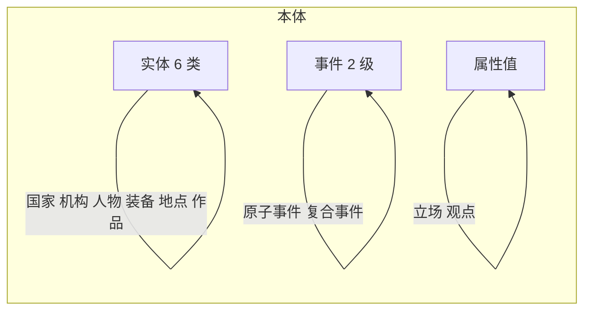

# 本体与关系设计方案

> 对应实现：[extract/kg_extract.py](../extract/kg_extract.py)、[extract/composite.py](../extract/composite.py)
> 标注口径见 [三任务标注规范.md](三任务标注规范.md)

## 一、设计出发点

早期方案把十类对象一律当实体抽取，暴露三个问题：

1. **平台与文档元数据重复。** 361 个平台节点里 30% 孤立，且媒体名在 `NewsDoc.source_name`、`extra.outlet`、`extra.domain` 里已有，不需要从正文抽。
2. **观点、场景不可复用。** 观点 8589 个取值、场景 2233 个取值，无一重复，全部只引用一次，是句子片段而非可复用对象。
3. **事件粒度混杂。** 单篇抽出 14 个事件，从「空袭」两字到 49 字长句同列，无主语的片段与完整陈述混在一起。

关系层的问题更严重：「实施」10937 条覆盖 41 种动词，从「空袭」「打击」到「记者会」「签署」全用它；「参与」2700 条里 72% 无法归类。一个关系名同时承担了语义角色、动作类型、端点类型三层信息。

由此确立两条原则：**实体只收可跨文复用的对象，动作类型从关系名上移到事件属性，关系只表语义角色。**

## 二、本体结构



### 2.1 实体六类

| 类型 | 定义 | 判据 | 不收 |
| --- | --- | --- | --- |
| 国家 | 主权国家与地区 | 命中国家名单，如中国、美国、俄罗斯、阿联酋 | 由机构派生的称谓，如「美国政府」「美军」 |
| 机构 | 政府、军队、部门、国际组织；带机关后缀的称谓 | 可独立标识并跨文复用 | 国家本身；职务串；职务描述式名称，如「一名发言人」 |
| 人物 | 有姓名的自然人 | 有专名 | 记者、通讯员、消息人士、分析人士；纯职务串 |
| 装备 | 武器、系统、舰船、飞机 | 有型号或明确指代，取原文写法 | 泛称，除非原文无型号 |
| 地点 | 地名、海域、基地、具体设施 | 具有空间层级 | 事件发生的机构场所 |
| 作品 | 有正式题名的协议、条约、法案、报告、影像 | 题名在原文出现且跨稿出现 | 无题名的口头承诺 |

**国家与机构分开。** 早期把国家作为机构的子类，用 `subtype=国家` 标记。这种做法在同一实体被标成两种类型时暴露出问题：实测「伊朗」机构 40 次、地点 9 次，「阿联酋」标成机构，而「终点」槽位只接受地点，导致「以色列在阿联酋部署铁穹」这条事件的终点被丢弃。

现在国家是独立类型，与机构并列。判定规则：
- 命中 119 国名单的名词一律算国家，代码层强制纠正，不看模型给的类型（计入 `entity_country_fixed`）
- 「美国」是国家，「美国国防部」「美军」是机构，两者不同
- 国家名不再兼作地点，需要地理含义时由槽位类型放宽解决
- 类型优先级：国家 > 机构 > 地点 > 人物 > 装备 > 作品

**职务串不是实体。** 职务、官衔、职业称呼只是称谓，不进实体表。

| 形态 | 示例 | 处理 |
| --- | --- | --- |
| 纯职务 | 美国总统、伊朗军方发言人 | 丢弃 |
| 职务 + 人名 | 美国总统特朗普 | 只保留姓名，职务写进人物属性的「身份/职业」 |
| 职务 + 机关后缀 | 总统府、国防部、俄军总参谋部 | 机构 |
| 职务 + 文书后缀 | 总统令 | 作品 |
| 集体泛称 | 西方领导人、俄美乌三国代表 | 丢弃 |

理由是新闻稿几乎都写清人名：含职务串人物的稿件里，九成以上同篇还有其他人名实体；余下的要么只写职务未写名字，要么是「核心指挥官」「西方领导人」这类泛称，都不是人名。职务串没有独立成节点的必要。

**职务串仍可作事件成立的依据。** 「伊朗军方发言人表示」确实指出了施动者，事件保留，只是缺一个施事论元。若该事件的施事只能落到职务串上，这条边丢弃，事件本身留下。

**装备取原文写法，不补字。** 三种情况：型号带通名时取完整片段（「F-35 战斗机」）；只有型号时只取型号（「F-16」）；全篇无型号才抽通名（「无人机」）。补字会让实体不再是原文子串，无法追溯。

**同名只算一个节点。** 图谱按文档建节点，同一实体在一篇里出现多次只记一条，不逐处标注。既没进关系也没作事件端点的孤立实体会被后处理丢弃，因此抽取阶段宁可多抽。

### 2.2 事件：独立于实体的节点类型

**事件不是实体，但仍是图的节点。** 这一区分很重要：

- 事件不能作为实体关系的端点，实体与实体之间的关系（隶属、辖属、驻地）只在实体之间建立。
- 事件通过角色关系连接实体，即「事件 —施事→ 国家/机构」而不是「机构 —实施→ 事件」。
- 事件与实体分开统计，实体 F1 只算六类，事件抽取单独报告。

这样处理的理由：关系里九成以事件为端点，若事件不进图，这些关系全部失效；而把事件排除在实体之外，避免了「事件也是实体」带来的统计混淆。

**两级事件：**

| 层级 | 定义 | 生成方式 |
| --- | --- | --- |
| 原子事件 | 「谁做了什么」的完整陈述，8 至 90 字，有施动者与单个主谓结构 | 块内联合抽取 |
| 复合事件 | 对同篇多个原子事件的概括，10 至 40 字 | 稿件级单独调用 |

**连接方式**：`包含` 关系，方向为复合事件 → 原子事件。这是唯一允许自类型成环的关系。

原子事件不足 2 个的稿件，用标题生成一个兜底复合事件，标 `fallback=true`。

**事件的字段：**

| 字段 | 含义 | 要求 |
| --- | --- | --- |
| `text` | 事件原文片段 | 8 至 90 字，自带施动者，是原文子串 |
| `event_type` | 一级类型，行为性质 | 7 选 1 |
| `subtype` | 二级类型，具体动作 | 属于该一级，可空 |
| `kind` | 时序 | 发生 / 计划 |
| `trigger` | 触发词 | 事件片段内最有代表性的动作词，1 至 12 字，是原文子串 |
| `raw_time` | 原文时间表述 | 逐字取自原文，如「当地时间28日傍晚」「当天」 |
| `time_norm` | 归一日期 | 由 `raw_time` 与发稿日推出，格式 `YYYY-MM-DD`，解不开留空 |
| `time_precision` | 时间精度 | day / week / month / interval / fuzzy / unknown |

**为什么要触发词。** 事件检测模型的训练目标是「给一段文本，找出其中的事件并定位触发词」，没有触发词就无法训练这类模型，也无法评测它的定位能力。早期版本把整个事件文本当作 `trigger`，等于没有触发词。

**为什么要单独存时间。** 事件节点早期只有见报日可参考，但新闻里大量写的是「3 日凌晨」「上周三」这类相对时间。不抽出来就无法排事件时序，也无法判断两篇报道讲的是不是同一天的事。归一由 `graph/time.py` 完成：能解成绝对日期的直接填 `time_norm`，「当天」「随后」这类相对表述以发稿日或前一个事件的日期为锚点，解不开的留空并把精度标为 unknown。

**事件类型分两层：**

| 枚举 | 取值 | 作用 |
| --- | --- | --- |
| `event_type` | 对抗、部署、合作、表态、灾伤、治理、其他 | 一级：行为性质 |
| `subtype` | 见下表，按一级分化 | 二级：具体动作 |
| `kind` | 发生、计划 | 时序，与是否真实发生无关 |

| 一级 | 二级 |
| --- | --- |
| 对抗 | 打击、空袭、拦截、发射、控制 |
| 部署 | 投送、机动、战备、演习、撤离 |
| 合作 | 签署、谈判、会议、访问、援助 |
| 表态 | 声明、呼吁、警告、否认、承认、谴责 |
| 灾伤 | 伤亡、事故 |
| 治理 | 立法、司法、人事、行政 |
| 其他 | 不分二级 |

**为什么要分层。** 早期把 16 个类型平铺，抽象层次混杂：「空袭」与「打击」并列，但空袭本是打击的一种；「声明」单类占近一半，无法细分。分层后判定顺序变为「先判性质，再判动作」，标注时先 7 选 1、再 2–6 选 1。设计参照 CAMEO 的层级编码思想，并借鉴其把表态细分的做法。

**为什么删掉场合维度。** 早期设计有 `setting`（场合）与 `event_type` 并列，两者有 7 个词重复（演习、访问、会议、谈判、签署、部署、其他），产生大量 `部署 × 部署` 这类无意义组合；`setting=其他` 又占三成。场合信息既不独立也不可靠，故删除，把动作细分统一放到 `subtype`。

**部署为什么要拆。** 若一级与二级同名（`部署 · 部署`），读起来自相矛盾，标注员无从判断。按动作阶段拆成投送（把兵力送到某地）、机动（已在移动途中）、战备（改变戒备状态）、演习、撤离，每个词只说一件事。

**表态不再进 kind。** 早期用 `kind=表态` 表达言语行为，与 `event_type=声明` 重复。现在「表态」是一级类型，`kind` 只表发生与计划。

**判定依据是事实本身，不是有无引述动词。** 新闻稿几乎每句话都来自某方口径，「称」「表示」「宣布」不改变事实的性质。

| 原文 | 归类 | 理由 |
| --- | --- | --- |
| 美方称空袭了伊朗 | 对抗 · 打击 | 事实是空袭 |
| 科威特方面报告称遭无人机袭击 | 对抗 · 打击 | 事实是遭袭 |
| 美方宣布将增兵 | 部署 · 投送，kind=计划 | 事实是将增兵 |
| 美方谴责伊朗空袭 | 表态 · 谴责 | 被转述的是态度，非动作 |
| 伊方否认参与袭击 | 表态 · 否认 | 只有评价，无动作 |

早期规则把一切转述判为表态，导致表态一类吞掉近八成事件，动作事实全部淹没。改为按事实分类后，表态回归为「只表达态度、评价或立场，不陈述具体动作」的窄类。

### 2.2.1 三任务划分

本体按 NER、EE、RE 三个任务组织，各任务有独立的数据卷、标注内容与评测指标。

| 任务 | 覆盖 | 端点 | 指标 |
| --- | --- | --- | --- |
| NER | 六类实体 | — | 片段加类型 F1 |
| EE | 原子事件、复合事件、按类型分化的槽位 | 事件 → 实体 | Trg-F1、Arg-F1 |
| RE | 10 种结构关系 | 实体 → 实体 | 三元组 P/R/F1 |

事件归 EE，不归 NER，不算实体。三个任务的指标分开报，不合成单一总分。数据卷由 `python3 -m dataset.build` 生成，导出格式由 `python3 -m dataset.export` 生成，NER 对齐 BIO，EE 对齐 CMNEE，RE 对齐 DuIE。

### 2.3 属性值两类

这两类不进图，分别落到不同载体。

| 载体 | 内容 |
| --- | --- |
| `表态` 边的 `stance` | 支持、反对、谴责、警告、否认、承认、呼吁、要求、关切、中立 |
| 事件的 `claims` 属性 | 原句加说话人 |
| 文档元数据 | 平台名落 `NewsDoc.source_name`、`extra.outlet`、`extra.domain` |

## 三、关系体系

### 3.1 设计原则

关系名只表**语义角色**，不表动作类型，不表端点类型。动作类型交给事件的 `event_type`，端点类型由 `DOMAIN` 表约束校验。这样每条关系语义唯一，不再有「实施」这种万能桶。

### 3.2 关系与槽位

关系按端点性质分三类，分别归属三个任务。角色与包含归 EE，结构关系归 RE。

**角色关系（以事件为起点，归 EE）**

早期所有事件类型共用同一组角色（施事、受事、使用、涉及、到场、表态），「使用」一个槽位同时装了发射平台（无人机、坦克）和发射物（导弹、炮弹），语义混淆。

第二代改为「通用槽位 + 按类型分化的专属槽位」，但保留了施事/受事/涉及三个通用角色。实测发现这层通用角色是重复填充的来源：同一事件里施事与甲方/表态方/主体并存 25 次，其中 15 次值完全相同（如「合作·签署 施事=泰国第一军区，甲方=泰国第一军区」）。同时约束口径在注释（说受事是通用）与代码（硬编码 `("施事","涉及","包含","到场")`，漏了受事）之间不一致，直接导致标注端把施事显示成受事。

**现在取消通用层，每个二级类型声明一套封闭论元，施动角色按类型起专名。**

| 类型 | 论元（* 为必填） |
| --- | --- |
| 对抗·打击 / 空袭 | 打击方*、受击方、打击对象、事发地点、发射平台、发射物、战果 |
| 对抗·拦截 | 拦截方*、拦截对象*、袭击方、事发地点、发射平台、发射物、战果 |
| 对抗·发射 | 发射方*、发射平台、发射物*、打击对象、事发地点 |
| 对抗·控制 | 控制方*、受控方、控制对象、事发地点 |
| 部署·投送 / 机动 | 部署方*、兵力*、起点、终点* |
| 部署·战备 | 部署方*、兵力、终点 |
| 部署·演习 | 部署方*、兵力、起点、终点 |
| 部署·撤离 | 部署方*、兵力*、起点*、终点 |
| 合作·签署 | 甲方*、乙方*、协议*、结果 |
| 合作·谈判 | 甲方*、乙方*、议题、结果 |
| 合作·会议 | 主办方*、参会方、到场、议题 |
| 合作·访问 | 访问方*、受访方*、目的 |
| 合作·援助 | 援助方*、受援方*、援助内容* |
| 表态·声明 / 否认 / 承认 | 表态方*、对象、表态内容* |
| 表态·呼吁 / 警告 / 谴责 | 表态方*、对象、表态内容*、议题 |
| 灾伤·伤亡 / 事故 | 受灾对象*、事发地点、伤亡数字、原因 |
| 治理·立法 | 主体*、法案*、处置结果 |
| 治理·司法 | 主体*、涉案对象*、处置结果 |
| 治理·人事 | 主体*、任免对象*、处置结果 |
| 治理·行政 | 主体*、行政对象、处置结果 |
| 其他 | 施动方、对象 |

定义集中在 `extract/slots.py`，提示词、校验、标注前端三处都从那里取，不再各写一份。

**受击方 / 打击对象 / 事发地点 三者的分工**是这一层最容易混的地方，按「谁」「什么」「哪」三分：

```
以军空袭加沙地带北部的哈马斯指挥所
  打击方 → 以军                （谁打的）
  受击方 → 哈马斯              （被打了谁，须是国家/机构/武装组织）
  事发地点 → 加沙地带北部       （在哪打的，地理范围）
  打击对象 → 哈马斯指挥所       （打了什么，具体设施）
```

**为什么要拆出「事发地点」**：早期只用一个「打击对象」承载全部地点信息，实测 268 条打击对象里，只有 13% 是真正的具体设施，其余是：

| 粒度 | 占比 | 例子 |
| --- | --- | --- |
| 行政区/区域 | 25% | 布什尔省、库尔斯克州、黎巴嫩南部、加沙地带 |
| 无后缀地名 | 37% | 约旦河西岸、耶路撒冷、卡杜格利 |
| 装备 | 16% | 弹道导弹、油轮 |
| 泛称设施 | 9% | 弹药库、雷达站、石油设施 |
| **具体设施** | **13%** | 扎波罗热核电站、以军导弹防御基地 |

一个槽位同时装「布什尔省」和「扎波罗热核电站」，粒度差了两个数量级，下游无法判断「这次打击的破坏规模」。拆开后两者各归其位：

- **打击对象**只收能被摧毁的具体目标：基地、机场、指挥所、核电站、工厂、雷达站、装备
- **事发地点**只收地理范围：省、州、市、地区、地带、海峡

判据一句话：**问「炸的是什么东西」→ 打击对象；问「在哪个地方炸的」→ 事发地点。**

**「事发地点」不只用于对抗类，灾伤类同样需要。** 早期灾伤类只有「受灾对象」，
实测 36 个灾伤事件里 61% 的论元含地点，且大量混淆：

```
受灾对象 = 中学、私人住宅、行政建筑、沃罗涅日市
                            ^^^^^^^^^^ 城市被当成受灾对象
受灾对象 = 卡杜格利          ^^^^^^ 城市名，应是事发地点
```

这与对抗类的「打击对象混入区域」是同一类错误。现在灾伤类也拆为：

| 槽位 | 收什么 | 例子 |
| --- | --- | --- |
| 受灾对象 | 伤亡方或具体受损设施 | 平民、某部队、某医院、某学校 |
| 事发地点 | 地理范围 | 卡杜格利、沃罗涅日市、加沙地带 |

判据相同：**问「谁受伤/什么被毁」→ 受灾对象；问「在哪个地方」→ 事发地点。**
原文只写区域不写具体目标时，只填事发地点，打击对象留空，不拿区域凑。

地点一律不进受击方。早期三者在同一槽位里混用，实测打击类的地点端点 201 条、机构 127 条、装备 62 条，分不清「谁被打了」「打了什么」「在哪打的」。

**「发射平台」与「发射物」必须分清**：

```
以军无人机向帐篷发射了两枚导弹
  发射平台 → 无人机
  发射物 → 导弹
```

**「战果」必须带对象**，只记后果，不记来袭规模：

```
正例：袭击造成19名平民死亡   → 战果=19名平民死亡
反例：战果=13               （只有数字，不知是什么）
反例：遭到44枚导弹袭击       → 44枚是发射物，不是战果
```

**部署类补了「战备」的终点。** 早期「战备」只有兵力槽位，但 28 个战备事件里大量文本含地点（「日本多地加强军事部署」），实测部署类 30 个事件提到地点却没有起终点，一半以上是战备。

**「部署方」是同名多义**：作事件论元时是 事件→机构，作装备关系时是 装备→机构。校验与数据集切分都按头端点类型判别，不能只看名字。

**「涉及」已取消**，它原来在合作类装协议、在对抗类装停火协议、在表态类装报告，语义不统一。现在合作类用「协议」，表态类用「议题」，对抗类不再需要。

**「包含」不属于论元**，它是复合事件与原子事件之间的结构关系，由 `composite.py` 单独产生，不走类型槽位校验。实测该环节尚未接入主流程，边数为 0。

**槽位的类型约束。** 每个二级类型只允许挂该类型声明的槽位，越界的边在校验阶段丢弃（计入 `relation_slot_not_allowed`）。这条约束由 `TYPE_SLOTS` 表定义，例如「合作·签署」只允许 `甲方/乙方/涉及/结果`，不允许 `发射物`。

**「字面值」端点。** 伤亡数字、议题、结果、战果、表态内容这类槽位的值往往是一个数字或短语，不是可复用实体。这类边只校验起点，不要求终点在实体表里。

**结构关系（10 种，实体之间，归 RE）**

前五种是机构与装备的派生属性，后五种补人物与地点维度。

| 关系 | 方向 | 含义 | 例 |
| --- | --- | --- | --- |
| 隶属 | 机构/国家 → 机构/国家 | 上级机关 | 五角大楼 —隶属→ 美国国防部 |
| 辖属 | 机构/国家 → 国家 | 国别归属 | 韩国国防部 —辖属→ 韩国 |
| 驻地 | 机构 → 地点 | 常驻位置 | 美军中央司令部 —驻地→ 卡塔尔 |
| 部署方 | 装备 → 机构/国家 | 装备由谁部署 | 爱国者系统 —部署方→ 美军 |
| 去向 | 装备 → 地点/国家 | 装备实际移动到某地 | 林肯号 —去向→ 中东 |
| 任职 | 人物 → 机构/国家 | 原文写明职务与机构的对应 | 赫格塞思 —任职→ 美国国防部 |
| 会晤 | 人物 → 人物 | 面对面或通话 | 特朗普 —会晤→ 塞西 |
| 搭载 | 装备 → 装备 | 载体与载荷 | 台风战机 —搭载→ 流星导弹 |
| 位于 | 地点 → 地点 | 行政或地理包含 | 塔伊兹省 —位于→ 也门 |
| 敌对 | 机构/国家 → 机构/国家 | 交火、宣战、明确对抗 | 以军 —敌对→ 哈马斯 |

补后五种的理由：原方案的结构关系都是机构或装备的派生属性，缺人物与地点维度。补上之后，实体间的图才有骨架，不依赖事件中转。

### 3.2.1 结构关系的边界

| 组 | 判据 |
| --- | --- |
| 任职 / 隶属 | 任职一端人物、一端机构或国家；隶属两端都是机构或国家。「曾在该机构工作」不算任职 |
| 会晤 / 到场 | 会晤是人物间的稳定关系；「出席某会议」是事件的论元 |
| 搭载 / 发射平台 | 搭载是装备之间的稳定装载关系；「事件动用某装备」是事件的发射平台论元 |
| 位于 / 驻地 | 位于两端都是地点；部队在某地是驻地 |
| 敌对 / 表态 | 敌对要求具体对抗事实；仅有口头交锋归表态的 `stance` |
| 受事 / 打击对象 | 受事是国家、机构、人物、装备；地点和具体设施走打击对象 |

### 3.3 方向统一的意义

所有角色关系都以事件为起点，带来两个好处：

一是元路径不用来回翻转。旧方案里「机构 —实施→ 事件 —使用→ 装备 —部署→ 机构」方向不一致，查询要逐段判断正向反向。新方案「事件 —发射物→ 装备 —部署方→ 机构 —辖属→ 国家」三步同向。

二是扇出查询天然成立。给一个事件，一次取出施事、受事、打击对象、发射物、战果等全部槽位，不需要正反两个方向各查一遍。

### 3.5 事件间关系

实体关系之外，事件之间还有四类关系。这是「事件图谱」区别于「实体图谱 + 事件节点」的关键。

| 关系 | 含义 | 判定方式 | 实测数量 |
| --- | --- | --- | --- |
| **子事件** subevent | 复合事件包含原子事件 | 复合事件生成时附带 | 668 |
| **时序** temporal | A 发生在 B 之前 | 规则比较时间戳 | 259 |
| **因果** causal | A 导致 B | 规则预筛 + LLM 判定 | 8 |
| **共指** coref | 多篇报道的同一事件 | 规则预筛 + LLM 确认 | 合并节点，不建边 |

**为什么判定方式不同**

这个分工来自实测证据，不是随意选择：

- **时序不用 LLM**。两个事件的时间戳一比就知道先后，模型反而容易错。ACL 2024 的评测明确指出 ChatGPT「在判断两个事件的时序关系上不具备同等专业能力」。
- **因果必须用 LLM**。同一篇评测显示 ChatGPT 在因果判定上「表现出色」，COPA 准确率 95.2、e-CARE 79.6，**均超过微调 RoBERTa（90.6 / 70.7）**。零样本即可，不需要微调。

**因果判定的两个坑**

1. **同一事件的不同表述被误判为因果**。反例：「乌克兰无人机袭击圣彼得堡」→「圣彼得堡市长称该市遭袭」，这是同一事件，不是因果。已在提示词中列出三种必须判 none 的情况：同一事件不同表述、同一行动不同阶段、仅共享参与方。
2. **方向矛盾**。同一对事件可能出现「A→B」和「B→A」都被判成立。处理方式是按时间先后保留「早→晚」那条——因果必须原因在前。

**大事件（复合事件）的定义方式**

不用稿件标题，也不用主题聚类：

- **标题不能用**：实测 200 篇里只有 2% 的标题能与原子事件文本对应，其余是编辑概括（「以军持续袭击约旦河西岸 抓捕20多人」对应两个事件）或全局统计（「一年内发动近600次打击」）。
- **主题聚类不能用**：`theme` 模块产出 1369 条主题线，中位数 1 篇、最大 749 篇。s0228 那条含 749 篇稿件，涵盖「伊朗备战」「伊朗表态」「伊朗遭袭」全部内容，是**议题**不是事件。
- **采用 LLM 篇内归纳**：一篇有 ≥2 个原子事件时，归纳出 1~3 个复合事件并指定覆盖哪些原子事件。实测 294 个复合事件覆盖 96% 的原子事件，且是真正的上位概括而非重述。

### 3.6 关系与动作类型的分离


同一个动作，在旧方案里可能落到不同关系名下，在新方案里只有 `event_type` 不同：

| 陈述 | 旧方案 | 新方案 |
| --- | --- | --- |
| 美军空袭伊朗 | 实施 | 事件(对抗·空袭) —施事→ 美军，—受事→ 伊朗 |
| 美军拦截无人机 | 拦截 | 事件(对抗·拦截) —施事→ 美军，—拦截对象→ 无人机 |
| 美军部署爱国者到卡塔尔 | 部署 | 事件(部署·投送) —施事→ 美军，—兵力→ 爱国者，—终点→ 卡塔尔 |
| 美伊签署协议 | 签署 | 事件(合作·签署) —甲方→ 美国，—乙方→ 伊朗，—涉及→ 协议 |

## 四、抽取约束

### 4.1 事件层

原子事件必须同时满足：

- 有施动者，且在实体表中找得到
- 单个主谓结构，不含目的从句、结果从句
- 长度 8 至 90 字
- 不含条件句标记（如果、若、假如、一旦）

条件句与推测句不算事件：「如果美以发动打击」是条件，「可能由苏丹快速支援部队发动」是推测。

事件文本必须自带施动者，不能靠关系补：「日本强行部署远程导弹」而不是事件写「强行部署远程导弹」再用关系连到日本。

### 4.2 关系层

- 两端都必须出现在实体表或事件表里，且类型符合 `DOMAIN`
- 记者、发言人、消息人士不得作为施事、受事、表态的端点
- 计划类事件不产生 `发射平台`、`发射物`、`兵力`、`部署方`、`去向`、`包含` 六条边
- `隶属` 与 `辖属` 不允许双向，同一对机构出现正反两条时保留证据较长的一条
- `表态方` 边的 `stance` 必须命中枚举，无明确态度词时不建边

### 4.3 时序判定

`kind` 只有两个取值：

- 发生：已发生或正在发生
- 计划：含计划标记（将、拟、考虑、讨论）且无完成标记（已、了、完成）

时态优先于言语动词：「已制定方案」判发生，不因含「制定」判计划。

`kind` 与 `event_type` 正交。「宣布将增兵」是 部署·投送 + 计划；「已经增兵」是 部署·投送 + 发生；「反对增兵」是 表态 + 发生。

## 五、与公开数据集的对照

| 项 | DuIE 2.0 | DocRED | CMNEE | 本方案 |
| --- | --- | --- | --- | --- |
| 语言 | 中文 | 英文 | 中文 | 中文 |
| 实体类型 | 按关系 schema 定义 | 实体提及加共指 | 7 类 | 6 类，事件单列 |
| 关系类型 | 48 | 96 | 8 | 38（28 槽位 + 10 结构） |
| 事件 | 无 | 无 | 8 类事件、11 论元 | 两级事件、7 类性质 × 27 类动作 |
| 粒度 | 句级 | 文档级 | 文档级 | 块级抽取加稿件级复合 |
| 任务划分 | RE | RE | EE | NER、EE、RE 三分 |

CMNIE（arXiv 2609.10722，2026）的 7 实体 8 关系与本方案最接近，且同为中文军事新闻，可作为对照基准。

## 六、设计取舍汇总

| 取舍 | 选择 | 理由 |
| --- | --- | --- |
| 十类对象 | 六类实体 + 事件节点 | 观点、场景取值无一重复，是句子片段；平台与文档元数据重复 |
| 事件归属 | 独立节点，不算实体 | 九成关系以事件为端点；与实体分开统计避免混淆 |
| 动作类型 | 从关系名上移到事件属性 | 「实施」一条关系覆盖 41 种动词，语义不唯一 |
| 事件类型 | 两层（性质 + 动作） | 16 类平铺层混杂，空袭与打击并列；分层后判定顺序清晰 |
| 场合维度 | 删除 | 与动作类型有 7 个词重复，三成取值为「其他」 |
| 表态归类 | 按事实分类，不按引述形式 | 否则表态吞掉八成事件，动作事实全部淹没 |
| 职务串 | 不入实体表 | 九成以上稿件同篇已有人名，职务串无法独立复用 |
| 装备命名 | 取原文写法，不补字 | 补字后不再是原文子串，无法追溯 |
| 关系方向 | 全部以事件为起点 | 元路径不用翻转，扇出查询一次取全 |
| 国家与机构 | 分成两类 | 国家名被混标成机构或地点，导致部署终点等边被类型约束丢弃 |
| 「使用」槽位 | 拆成发射平台与发射物 | 一个槽位同时装载体和载荷，无法回答「用什么打的」「打出去的是什么」 |
| 受事与打击对象 | 分成两槽 | 地点与机构混在受事里，分不清「谁被打了」和「打了什么」 |
| 战果 | 必须带对象 | 只记数字无法判断损失内容，来袭规模不应计入战果 |
| 表态内容 | 单列槽位 | 早期只有表态方，一半表态事件丢了说话内容 |
