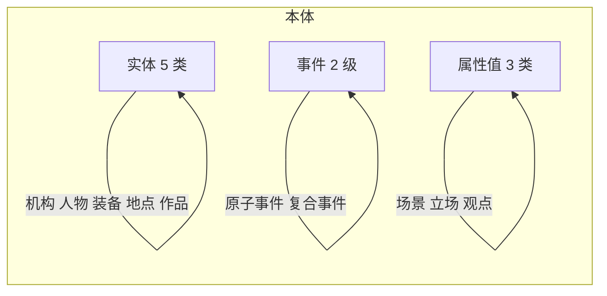

# 本体与关系设计方案

> 日期：2026-11-10
> 对应实现：[extract/kg_extract.py](../extract/kg_extract.py)、[extract/composite.py](../extract/composite.py)、[graph/build10.py](../graph/build10.py)

## 一、设计出发点

早期方案把十类对象一律当实体抽取，实测暴露三个问题：

1. **平台与文档元数据重复。** 361 个平台节点里有 30% 孤立，且媒体名在 `NewsDoc.source_name`、`extra.outlet`、`extra.domain` 里已有，不需要从正文抽。
2. **观点、场景不可复用。** 8589 个观点取值无一重复，2233 个场景取值无一重复，全部只引用一次，是句子片段而非可复用对象。
3. **事件粒度混杂。** 单篇抽出 14 个事件，从「空袭」两字到 49 字长句同列，无主语的片段与完整陈述混在一起。

第二个更严重的问题在关系层：「实施」10937 条覆盖 41 种动词，从「空袭」「打击」到「记者会」「签署」全用它；「参与」2700 条里 72% 无法归类。一个关系名同时承担了语义角色、动作类型、端点类型三层信息。

## 二、本体结构

### 2.1 实体五类

| 类型 | 定义 | 判据 | 不收 |
| --- | --- | --- | --- |
| 机构 | 政府、军队、部门、国际组织；带机关后缀的称谓 | 可独立标识并跨文复用 | 职务串（「美国总统」「国防部长」「俄军总参谋长」）；职务描述式名称，如「一名发言人」 |
| 人物 | 有姓名的公开身份；单独出现的职务串 | 有专名，或是明确指人的职务名 | 记者、通讯员、消息人士、分析人士 |
| 装备 | 武器、系统、舰船、飞机 | 有型号或明确指代 | 泛称仅在原文无型号时收 |
| 地点 | 地名、海域、基地 | 具有空间层级 | 事件发生的机构场所 |
| 作品 | 有正式题名的协议、条约、法案、报告、影像；带文书后缀的称谓 | 题名在原文出现且跨稿出现 | 无题名的口头承诺 |

国家作为机构的子类，标记 `subtype=国家`，与军队、部门各自编号。

**职务串按人物处理。** 「美国总统」「乌克兰总统」「以色列总理」「俄军总参谋长」「联合国秘书长」「俄总统新闻秘书」都指人，不是机关。这一条曾长期出错：全量 4115 篇里 610 个职务串被标成机构，涉及 479 篇，其中 304 篇同一主体裂成「美国总统」与「特朗普」两个节点。判据按后缀区分：

| 后缀情况 | 示例 | 类型 |
| --- | --- | --- |
| 职务词结尾 | 美国总统、国防部长 | 人物 |
| 职务词 + 人名 | 法国总统马克龙 | 人物，并入「马克龙」 |
| 职务词 + 机关后缀（府、办公室、部、局、院、委员会、司令部、秘书处） | 总统府、总统办公室、国防部、俄军总参谋部 | 机构 |
| 职务词 + 文书后缀（令、法、案、条例） | 总统令、总统法 | 作品 |

**一人一实体。** 原文写「美国总统特朗普」时，规范实体是「特朗普」，职务写进人物属性的「身份/职业」，不另立节点。

### 2.2 事件：独立于实体的节点类型

**事件不是实体，但仍是图的节点。** 这一区分很重要：

- 事件不能作为实体关系的端点，实体与实体之间的关系（隶属、辖属、驻地）只在实体之间建立。
- 事件通过角色关系连接实体，即「事件 —施事→ 机构」而不是「机构 —实施→ 事件」。
- 事件与实体分开统计，实体 F1 只算五类，事件抽取单独报告。

这样处理的理由：现有 921 条关系里有 830 条（90%）以事件为端点，若事件不进图，这些关系全部失效。而把事件排除在实体之外，避免了「事件也是实体」带来的统计混淆。

**两级事件：**

| 层级 | 定义 | 规模 | 生成方式 |
| --- | --- | --- | --- |
| 原子事件 | 「谁做了什么」的完整陈述，8 至 60 字，有施动者与单个主谓结构 | 每篇 3 个左右 | 块内联合抽取 |
| 复合事件 | 对同一篇稿件多个原子事件的概括，10 至 40 字 | 每篇 1 至 3 个 | 稿件级单独调用 |

**连接方式**：`包含` 关系，方向为复合事件 → 原子事件。这是唯一允许自类型成环的关系。

原子事件不足 2 个的稿件，用标题生成一个兜底复合事件，标 `fallback=true`。

**三个受控枚举：**

| 枚举 | 取值 | 作用 |
| --- | --- | --- |
| `event_type` | 空袭、打击、拦截、发射、部署、撤离、演习、控制、签署、谈判、会议、访问、逮捕、援助、声明、其他 | 动作类型，从关系名上移 |
| `kind` | 发生、表态、计划 | 话语功能，与是否真实发生无关 |
| `setting` | 战斗、演习、访问、会谈、记者会、视察、会议、谈判、审判、选举、签署、部署、巡逻、救援、其他 | 事件发生的场合形式 |

`event_type` 与 `setting` 正交：同一件事「空袭某地」与「在记者会上宣布空袭」，`event_type` 分别是空袭与声明，`setting` 分别是战斗与记者会。

`event_type` 的一条硬规则：`kind` 为表态时，`event_type` 一律填声明。转述内容里出现的空袭、部署等动作属于被转述方，不算本次事件的动作类型。这条规则有实证支撑：实测 99 条表态事件原本就 100% 是声明。

### 2.2.1 三任务划分

本体按 NER、EE、RE 三个任务组织，各任务有独立的数据卷、标注内容与评测指标。

| 任务 | 覆盖 | 端点 | 指标 |
| --- | --- | --- | --- |
| NER | 五类实体 | — | 片段加类型 F1 |
| EE | 原子事件、复合事件、7 种角色与包含关系 | 事件 → 实体 | Trg-F1、Arg-F1 |
| RE | 10 种结构关系 | 实体 → 实体 | 三元组 P/R/F1 |

事件归 EE，不归 NER，不算实体。三个任务的指标分开报，不合成单一总分。

标注卷在 `data/dataset/`，由 `python3 -m dataset.build` 生成；导出格式由 `python3 -m dataset.export` 生成，NER 对齐 BIO，EE 对齐 CMNEE，RE 对齐 DuIE。规范见 [三任务标注规范.md](三任务标注规范.md)。

### 2.3 属性值三类

这三类不进图，分别落到不同载体。

| 原类型 | 新定位 | 载体 |
| --- | --- | --- |
| 场景 | 枚举值 | 事件节点的 `setting` 字段 |
| 立场 | 枚举值 | `表态` 边的 `stance` 字段，取值 支持、反对、谴责、警告、否认、承认、呼吁、要求、关切、中立 |
| 观点 | 原句 | 事件的 `claims` 属性，记原句加说话人 |
| 平台 | 文档元数据 | `NewsDoc.source_name`、`extra.outlet`、`extra.domain` |

## 三、关系体系

### 3.1 设计原则

关系名只表**语义角色**，不表动作类型，不表端点类型。动作类型交给事件的 `event_type`，端点类型由 `DOMAIN` 表约束校验。

这样拆开的结果：关系名从 17 种改为结构化的 17 种，但每条语义唯一，不再有「实施」这种万能桶。

### 3.2 十七种关系

关系按端点性质分三类，分别归属三个任务。角色与包含归 EE，结构关系归 RE。

**角色关系（7 种，全部以事件为起点，归 EE）**

| 关系 | 方向 | 含义 | 例 |
| --- | --- | --- | --- |
| 施事 | 事件 → 机构/人物 | 发起或执行该事件 | 事件「空袭基辅」—施事→ 俄军 |
| 受事 | 事件 → 机构/人物/地点 | 被打击、被控制、被波及 | 事件「空袭基辅」—受事→ 基辅 |
| 到场 | 事件 → 人物 | 出席、参加，但不是施事 | 事件「举行会谈」—到场→ 特朗普 |
| 使用 | 事件 → 装备 | 事件中动用的装备 | 事件「空袭」—使用→ F-16 |
| 涉及 | 事件 → 作品 | 事件关联的文书 | 事件「签署协议」—涉及→ 吉达停火协议 |
| 表态 | 事件 → 机构/人物 | 谁就此事表态，边带 `stance` | 事件「否认指控」—表态→ 伊朗外交部 |
| 包含 | 复合事件 → 原子事件 | 概括层与细节层的连接 | 复合「也门战事升级」—包含→ 原子「空袭萨那」 |

**结构关系（10 种，实体之间，归 RE）**

前五种是机构与装备的派生属性，后五种补人物与地点维度。

| 关系 | 方向 | 含义 | 例 |
| --- | --- | --- | --- |
| 隶属 | 机构 → 机构 | 上级机关 | 五角大楼 —隶属→ 美国国防部 |
| 辖属 | 机构 → 机构 | 国别归属，终点是国家 | 韩国国防部 —辖属→ 韩国 |
| 驻地 | 机构 → 地点 | 常驻位置 | 美军中央司令部 —驻地→ 卡塔尔 |
| 部署方 | 装备 → 机构 | 装备由谁部署 | 爱国者系统 —部署方→ 美军 |
| 去向 | 装备 → 地点 | 装备实际移动到某地 | 林肯号 —去向→ 中东 |
| 任职 | 人物 → 机构 | 原文写明职务与机构的对应 | 赫格塞思 —任职→ 美国国防部 |
| 会晤 | 人物 → 人物 | 面对面或通话 | 特朗普 —会晤→ 塞西 |
| 搭载 | 装备 → 装备 | 载体与载荷 | 台风战机 —搭载→ 流星导弹 |
| 位于 | 地点 → 地点 | 行政或地理包含 | 塔伊兹省 —位于→ 也门 |
| 敌对 | 机构 → 机构 | 交火、宣战、明确对抗 | 以军 —敌对→ 哈马斯 |

新增五种的理由：原方案的结构关系都是机构或装备的派生属性，缺人物与地点维度。补上之后，实体间的图才有骨架，不依赖事件中转。

### 3.2.1 结构关系的边界

| 组 | 判据 |
| --- | --- |
| 任职 / 隶属 | 任职两端是人物与机构；隶属两端都是机构。「曾在该机构工作」不算任职 |
| 会晤 / 到场 | 会晤是人物间的稳定关系；「出席某会议」是事件的论元 |
| 搭载 / 使用 | 搭载是装备之间的装载；「事件使用某装备」是事件的论元 |
| 位于 / 驻地 | 位于两端都是地点；部队在某地是驻地 |
| 敌对 / 表态 | 敌对要求具体对抗事实；仅有口头交锋归表态的 `stance` |

### 3.3 方向统一的意义

所有角色关系都以事件为起点，带来两个好处：

一是元路径不用来回翻转。旧方案里「机构 —实施→ 事件 —使用→ 装备 —部署→ 机构」方向不一致，查询要逐段判断正向反向。新方案「事件 —使用→ 装备 —部署方→ 机构 —辖属→ 国家」三步同向。

二是扇出查询天然成立。给一个事件，一次取出施事、受事、到场、使用、涉及、表态六类角色，不需要正反两个方向各查一遍。

### 3.4 关系与动作类型的分离

同一个动作，在旧方案里可能落到不同关系名下，在新方案里只有 `event_type` 不同：

| 陈述 | 旧方案 | 新方案 |
| --- | --- | --- |
| 美军空袭伊朗 | 实施 | 事件(type=空袭) —施事→ 美军，—受事→ 伊朗 |
| 美军拦截无人机 | 拦截 | 事件(type=拦截) —施事→ 美军，—受事→ 无人机 |
| 美军部署爱国者 | 部署 | 事件(type=部署) —施事→ 美军，—使用→ 爱国者 |
| 美伊签署协议 | 签署 | 事件(type=签署) —施事→ 美国，—施事→ 伊朗，—涉及→ 协议 |

## 四、抽取约束

### 4.1 事件层

原子事件必须同时满足：

- 有施动者，且在实体表中找得到
- 单个主谓结构，不含目的从句、结果从句
- 长度 8 至 60 字
- 不含条件句标记（如果、若、假如、一旦）

条件句与推测句不算事件：「如果美以发动打击」是条件，「可能由苏丹快速支援部队发动」是推测。

事件文本必须自带施动者，不能靠关系补：「日本强行部署远程导弹」而不是事件写「强行部署远程导弹」再用关系连到日本。

### 4.2 关系层

- 两端都必须出现在实体表或事件表里，且类型符合 `DOMAIN`
- 记者、发言人、消息人士不得作为施事、受事、表态的端点
- 计划类事件不产生 `使用`、`部署方`、`去向`、`包含` 四条边
- `隶属` 与 `辖属` 不允许双向，同一对机构出现正反两条时保留证据较长的一条
- `表态` 边的 `stance` 必须命中枚举，无明确态度词时不建边

### 4.3 话语种类判定

优先级：

1. 转述他人言行（出现「称/表示/声明」且标记前有主体）→ 表态
2. 含计划标记（将、拟、考虑、讨论）且无完成标记（已、了、完成）→ 计划
3. 规范句（必须、应当、不得）→ 表态
4. 其余 → 发生

时态优先于言语动词：「已制定方案」判发生，不因含「制定」判计划；「发表声明」判表态，不因是动作判发生。

## 五、实测数据

### 5.1 三轮试点

| 指标 | 第一轮 | 第二轮 | 第三轮 |
| --- | ---: | ---: | ---: |
| 每篇事件 | 4.14 | 2.70 | 2.89 |
| 事件总数 | 1241 | 811 | 867 |
| 场景命中 | 76.6% | 74.0% | 73.1% |
| 类型命中 | 89.6% | 91.4% | 91.1% |

第三轮每篇 2.89 个事件、4.9 个实体、7.8 条关系。

### 5.2 事件类型与话语分布

第三轮 300 篇：

| 类型 | 数量 | | 话语 | 数量 |
| --- | ---: | --- | --- | ---: |
| 声明 | 280 | | 发生 | 583 |
| 打击 | 212 | | 表态 | 223 |
| 空袭 | 94 | | 计划 | 61 |
| 拦截 | 70 | | | |
| 发射 | 39 | | | |
| 其他 | 77 | | | |

### 5.3 关系分布

| 关系 | 数量 | | 关系 | 数量 |
| --- | ---: | --- | --- | ---: |
| 施事 | 814 | | 涉及 | 34 |
| 受事 | 609 | | 包含 | 30 |
| 使用 | 227 | | 驻地 | 26 |
| 隶属 | 99 | | 到场 | 19 |
| 表态 | 77 | | 去向 | 17 |
| 辖属 | 63 | | 部署方 | 12 |

对比旧方案的「实施 10937 条覆盖 41 种动词」，新方案最粗的「施事」814 条，全部是事件指向机构或人物，语义唯一。

### 5.4 复合事件

89 篇测试：原子事件 301 个，复合事件 120 个，`包含` 边覆盖 96.3% 的原子事件。原子事件不足 2 个的 20 篇由标题兜底生成复合事件。

## 六、与公开数据集的对照

| 项 | DuIE 2.0 | DocRED | CMNEE | 本方案 |
| --- | --- | --- | --- | --- |
| 语言 | 中文 | 英文 | 中文 | 中文 |
| 实体类型 | 按关系 schema 定义 | 实体提及加共指 | 7 类 | 5 类，事件单列 |
| 关系类型 | 48 | 96 | 8 | 17（7 角色 + 10 结构） |
| 事件 | 无 | 无 | 8 类事件、11 论元 | 两级事件、16 类型 |
| 粒度 | 句级 | 文档级 | 文档级 | 块级抽取加稿件级复合 |
| 任务划分 | RE | RE | EE | NER、EE、RE 三分 |

CMNIE（arXiv 2609.10722，2026）的 7 实体 8 关系与本方案最接近，且同为中文军事新闻，可作为对照基准。

## 七、待办

1. **表态与发生的判定。** 当前规则判定准确率约 85%，剩余错误集中在转述动词超出词表、句中动作词与转述词共存两类。提示中已加「表态时 event_type 固定声明」的硬规则，待新一轮验证。
2. **零事件篇的处理。** 全量中约 9% 的稿件只有实体与结构关系，无事件，已由复合事件兜底，待确认兜底质量。
3. **场景枚举的适配。** 场景「其他」占比 27%，主要是声明类事件确实无场合信息，需确认是否扩充枚举。
4. **RE 卷规模。** 现有语料以事件报道为主，100 篇里仅 29 篇有结构关系。扩大 RE 卷需要专门筛选含任职、会晤、敌对、搭载、位于语义的稿件，或引入外部语料。
5. **新增五种关系的样本量。** 试抽中任职 7 条、敌对 5 条、位于 5 条，会晤与搭载未出现，评测时需按关系种类分别报。
6. **职务串残留。** 已修（见 2.1），但提示词改动只对新抽取生效，历史数据需要跑 `extract/title_fix.py` 后验改判一次。改判时「实施」边改记为「施事」，全量 188 条得以保留，28 条因缺事件端点丢弃。
