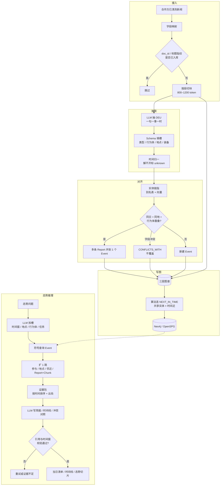
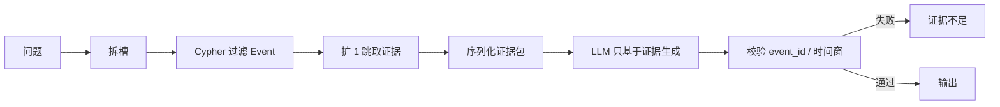

# 军事新闻知识图谱与态势分析 — 总体规划

> 版本：0.2  
> 日期：2026-08-25  
> 范围：合作方协议未定时，**本仓库过渡采集环球网军事**（仅公开栏目文字稿）。新浪军事因列表接口无法翻页已撤出。输入信封：`title / body / publish_time / source / url`。CMNEE 仍作评测集。  
> 实现进度与已知问题见 **[开发记录.md](开发记录.md)**（全量 711 篇后的现状，便于排期）。

---

## 1. 目标与边界

### 1.1 要做成什么

根据**每日入库的公开军事新闻**，增量构建知识图谱，并支撑态势分析。系统稳定产出四类结果：

| 产物 | 回答什么 |
|------|----------|
| 当日简报 | 今天新增哪些事件、热点地区、主要行为体 |
| 时间线 | 某行为体 / 某地区 / 某类事件在过去 N 天发生了什么 |
| 态势切片 | 某主题下的事件簇、参与方、先后关系、多源说法是否冲突 |
| 预警候选 | 新行为体出现、某类事件突增、同一事件口径不一致 |

新闻三元组是**报道主张**，不是已核实事实。每条边必须带来源、时间、原文片段、置信度。

### 1.2 明确不做

- 全网任意站点采集、绕过验证码/登录墙、评论区用户信息
- 非公开情报融合、作战筹划、目标清单、武器效能评估
- 用模型补全原文没有的数量、型号、意图
- 把「威胁 / 将攻击」写成高置信因果边

### 1.3 开发阶段如何看效果

数据流未接通前，用**离线金标 + 公开事件库**验收抽取、图谱合并和推理，不阻塞开发。

---

## 2. 总体架构

分层建设，不把某一套开源 GraphRAG 当唯一底座。

```text
公开军事新闻（过渡爬虫：环球网军事；日后可换合作方适配器）
    → 接入适配（NewsDoc 信封 / url+hash 去重）
    → LLM 抽动态事件单元 DEU
    → Schema 约束抽槽位（行为体 / 地点 / 装备 / 类型）
    → 实体对齐、事件多源合并、冲突标记
    → 写入：原文层 + 事件层 + 实体层
    → 态势：时间窗检索 → 子图证据包 → LLM 简报（带引用）
```

### 2.1 总流程图

日更构建（上半）与态势问答（下半）分开：构建只处理增量文档；问答只读子图，不回写事实。



### 2.2 推理环（问答侧）



| 层 | 可借鉴的现有仓库 | 职责 |
|----|------------------|------|
| 事件层 | DyG-RAG | 一句一事一时，时间窗与时间线 |
| 实体 / 关系层 | KAG `schema_constraint`、OneKE | 类型化槽位 |
| 开放补漏 | AutoSchemaKG 概念层 | 新词、新叫法先挂上，再收进 Schema |
| 主题综述 | GraphRAG 社区报告 | 周报级主题摘要，不当日更事实库 |
| 问答 / 多跳 | KAG solver、EventRAG Agent | 规划后检索，再生成 |
| 存储 | OpenSPG / Neo4j | 日增、类型约束、原文回溯 |

**不建议**用 HippoRAG 做主库（适合多跳检索，不适合态势主轴）；也**不建议**只用 GraphRAG（贵，且日更事实容易被摘要冲掉）。

---

## 3. 图谱结构

三层 + 溯源。查询走**事件层按时间/地点/类型过滤**，不是在整张实体网上随机跳。

```text
Document / Chunk              原文层（证据）
        ↑ SOURCED_FROM
Event / Report                事件层（态势主轴）
        ↑ PARTICIPANT / LOCATED_AT / MENTIONS_PLATFORM
Actor / Location / Platform   实体层（谁、在哪、提及什么）
```

### 3.1 节点

**原文层**

| 类型 | 关键属性 |
|------|----------|
| `Document` | `doc_id`, `title`, `source`, `publish_time`, `url`（可空） |
| `Chunk` | `chunk_id`, `text`, `doc_id` |

**事件层**

| 类型 | 关键属性 |
|------|----------|
| `Event` | `event_id`, `event_type`, `event_time`, `time_granularity`, `status`（confirmed / single_source / conflicting） |
| `Report` | `report_id`, `sentence`, `context`, `raw_time_text`, `extract_confidence` |

同一件事多家媒体报道：1 个 `Event`，多条 `Report`。

**实体层**

| 类型 | 说明 |
|------|------|
| `Actor` | 国家、组织、人物（仅公开身份） |
| `Location` | 国家 / 海域 / 城市，尽量挂标准地名 |
| `Platform` | 报道中的装备名称；`name` 保留原文，`canonical_name` 能对齐再填 |

`event_type` 第一期枚举：`演习` / `部署` / `表态` / `事故冲突` / `采购研发` / `外交` / `其他`。

### 3.2 边

| 边 | 方向 | 含义 |
|----|------|------|
| `CONTAINS` | Document → Chunk | 文档切块 |
| `SOURCED_FROM` | Report → Chunk | 原句出处 |
| `REPORTS` | Report → Event | 该报道对应哪件规范事件 |
| `PARTICIPANT` | Actor → Event | 参与；属性 `role`：发起 / 对象 / 提及 |
| `LOCATED_AT` | Event → Location | 发生地 |
| `MENTIONS_PLATFORM` | Event → Platform | 报道提及的装备 |
| `NEXT_IN_TIME` | Event → Event | 跨块/跨文档：实体 Jaccard × \(e^{-\alpha\Delta t}\)，每点最多 6 条。同块不连（交给 `TLINK`）。**算法邻近，不是因果** |
| `CONFLICTS_WITH` | Report → Report | 时间或规模等说法冲突 |

边上固定带：`publish_time`, `source_id`, `extract_confidence`。

**不要**把「威胁 / 将攻击 / 导致」做成高置信边。最多写入 `Report.claim_text`，或低置信 `ALLEGES`。

### 3.3 结构示例

新闻 A（8/20）：甲国海军舰艇编队 8 月 20 日在某海峡展开演习。  
新闻 B（8/21）：甲国昨日在该海峡举行实弹演练，出动驱护舰。

```text
(DocA)-CONTAINS->(ChunkA)
(DocB)-CONTAINS->(ChunkB)

(ReportA {time: 2024-08-20, sentence: …演习})
    -REPORTS-> (Event#E1 {type: 演习, time: 2024-08-20, status: confirmed})
    -SOURCED_FROM-> ChunkA

(ReportB {time: 2024-08-20, sentence: …实弹演练})
    -REPORTS-> Event#E1
    -SOURCED_FROM-> ChunkB

(Actor:甲国海军)-PARTICIPANT{role:发起}-> Event#E1
(Event#E1)-LOCATED_AT->(Location:某海峡)
(Event#E1)-MENTIONS_PLATFORM->(Platform:驱护舰)
```

若次日出现乙国表态，新建 `Event#E2`，与 E1 用 `NEXT_IN_TIME` 相连，**不**写成「E1 导致 E2」。

---

## 4. 处理流水线（不含爬虫）

约定输入字段：`doc_id`, `title`, `body`, `source`, `publish_time`，可选 `url` / `lang`。

1. **接入适配**：字段映射；按 `doc_id` / 标题指纹跳过已入库文档。  
2. **切块**：按段，约 800–1200 token，标题写入 chunk 上下文。  
3. **抽 DEU（LLM）**：一句一事一时；禁止代词；区间取最早点；解不开标 `unknown`。  
4. **填槽（LLM + Schema）**：事件类型、行为体、对象、地点、装备；原文没有的槽位留空。  
5. **实体对齐**：别名表 + 向量近邻 → 标准名。  
6. **事件合并**：同一日 + 同地点 + 行为体重叠高 → 合并为 1 个 `Event`；对不上则 `CONFLICTS_WITH`，禁止覆盖。  
7. **写图**：事件进动态事件图；实体关系进 Neo4j / OpenSPG；Chunk 与 Report 互链。  
8. **算法连边**：共享实体 × 时间衰减，生成 `NEXT_IN_TIME`（每事件上限条数，如 6）。

每日只处理增量文档，禁止全量重抽。

---

## 5. 图谱上的 LLM 推理

原则：**图负责取证和约束，LLM 负责拆槽、叙述和写简报。** 禁止把整图塞进上下文，禁止脱离证据「研判」。

### 5.1 标准推理环

```text
问题
  → LLM 拆槽：时间窗 / 地点 / 行为体 / 事件类型 / 任务类型
  → 符号检索：过滤 Event（时间、地点、类型）
  → 扩 1 跳：PARTICIPANT、LOCATED_AT、NEXT_IN_TIME、Report、Chunk
  → 序列化为证据包（事件按时间排序，每条带出处）
  → LLM 只基于证据包生成
  → 校验：结论是否带 report_id / event_id；时间是否落在窗内
```

### 5.2 任务类型（写死，便于评测）

| 任务 | 图怎么取 | LLM 做什么 |
|------|----------|------------|
| 当日清单 | `event_time = 当天` | 去重列表，按地区分组 |
| 时间线 | Actor / Location + 时间窗 | 按时间叙述，区分持续 / 瞬时 |
| 共现 | 两 Actor 共同挂接的 Event | 列出共现，不升格为「结盟」 |
| 冲突 | 同一 Event 下 Report 不一致 | 对照两源，写分歧 |
| 主题综述 | 近 N 天事件聚类后再取 | 写简报，每段挂 event_id |

### 5.3 三种用法

- **符号先行（第 1 期主路径）**：Cypher / 等价查询取出子图，再生成。  
- **Time-CoT**：事件按时间排列；任职/部署视为持续到明确结束；问题要某日状态则只用 ≤ 该日且未被结束事件打断的证据。  
- **多步 Agent（第 2 期）**：工具限定为 `search_events` / `expand_participants` / `get_reports` / `find_conflicts`，输出必须是表，不允许模型「想起」装备型号。

### 5.4 生成后硬校验

- 结论句必须含 `event_id` 或 `report_id`  
- 时间必须落在解析出的窗口内  
- 不满足则重试或返回「证据不足」

### 5.5 分工

| 阶段 | 执行方 |
|------|--------|
| 抽 DEU、填槽、解析问题时间窗 | LLM |
| 对齐、合并、写边、按日查询 | 程序 + 图数据库 |
| 清单 / 时间线 / 冲突对照 | LLM（只看子图） |
| 频次变化、新行为体 | 统计，不用 LLM |

---

## 6. 评测：数据与指标

数据方未就绪时，用三类数据叠起来。

### 6.1 数据

**（优先）迷你金标**  
向数据方要，或从公开报道自备 **30–80 篇**、覆盖 7–14 天、至少 2 个地区、同一事件至少 2 源。标注：

| 层 | 内容 |
|----|------|
| 事件单元 | 一句一事、事件时间、原句 |
| 槽位 | 行为体、对象、地点、装备、事件类型 |
| 对齐 | 同事件多源、实体标准名 |
| 态势题 | 10–20 道题 + 必须引用的原文 |

题目示例：「8 月 20 日该海域新增了哪些部署类事件？」「A 与 B 近 7 天共同出现在哪些事件？」「两家媒体对某演习的说法哪里不一致？」

**公开数据（补规模，不替代验收）**

| 数据 | 适合 | 不适合当最终验收 |
|------|------|------------------|
| GDELT / ICEWS | 事件四元组规模与日切稳定性 | 中文表述、装备别名、多源原文 |
| TimeQA / TempReason / ComplexTR | 时间约束、状态持续 | 军事槽位、事件合并 |
| HotpotQA 等 | 检索冒烟 | 态势 / 时间 / 冲突 |

### 6.2 指标

**抽取**

- 事件召回 / 精确（句子级软匹配）
- 时间准确率：年月日对、只对到年、`unknown` 分开统计；**错年算全错**
- 槽位微平均 F1：Actor / Location / EventType / Platform；原文无则空槽不罚
- 代词残留率：DEU 出现「他 / 该部队 / 其」计失败

**图谱**

- 实体链指准确率
- 事件合并 pairwise F1
- 冲突保留率（不该合并的未被合并）
- 溯源覆盖（边是否都有 `source_id` + chunk）

**推理 / 态势**

| 指标 | 含义 |
|------|------|
| 时间遵守率 | 答案是否落在问题时间窗 |
| 引用率 | 结论能否点回原文 |
| 忠实度 | 原文没有的数量 / 意图不得出现 |
| 事件召回@K | 金标事件是否进入证据包 |
| 冲突题正确率 | 能指出不一致，而不是选边站 |

LLM-as-judge 若使用，必须包含忠实度、时间、引用；不用「全面 / 多样」当主指标。

### 6.3 第 1 期过关线

- 时间准确率 ≥ 0.8（允许粒度粗，不允许错年）
- 槽位 F1 ≥ 0.6（Actor / Location / EventType）
- 态势题引用率 ≥ 0.9
- 时间遵守率 ≥ 0.9

---

## 7. 分期计划

### 第 0 期：约定与金标（约 1 周）

- 与数据方确认入库 JSON schema  
- 拿到或自建 50 篇语料，标 15 道态势题  
- 冻结本文的节点 / 边 / 指标

### 第 1 期：最小闭环（约 2–4 周）

- DEU 抽取 + 时间归一  
- 词典 / NER 实体 + 手写 Schema 槽位  
- Neo4j 写入三层结构  
- 推理只做一种：`解析时间窗 → 查询 Event+Report+Chunk → Time-CoT`  
- 对照第 6.3 节四个数字验收  

**完成标志**：不依赖爬虫，金标上能回答「某日某地发生了什么」，且条条有出处。

### 第 2 期：对齐与合并

- 别名表 + 向量链指  
- 多源事件合并与 `CONFLICTS_WITH`  
- 当日清单、时间线、冲突对照三种任务  
- 增量写入与幂等（同一 `doc_id` 不重复抽取）

### 第 3 期：态势产品

- 主题聚类 / 社区简报（近 7/30 天）  
- 频次与新行为体统计预警  
- 问答（KAG 式规划 或 EventRAG 式 Agent）  
- 审核台：改类型、别名、拆合事件

### 第 4 期（可选）

- AutoSchemaKG 概念层收新词  
- OpenSPG 规则（同地区连续事件等可解释推理）  
- 对接真实日更流，金标改为每日回归

---

## 8. 技术选型（初稿）

| 项 | 第 1 期建议 | 后续可选 |
|----|-------------|----------|
| 语言 | Python 3.10+ | — |
| 图存储 | Neo4j | OpenSPG |
| 向量 | NanoVectorDB / 本地 BGE | Milvus |
| 抽取 LLM | 已有 MaaS 或本机 vLLM | 抽 / 聊模型分离 |
| NER | 词典 + `bert-base-NER` 或中文 NER | 领域微调 |
| 编排 | 脚本 + Makefile | 简易任务队列 |

本仓库与现有代码的关系：优先**对照实现、按需移植**，不把整个 KAG / DyG-RAG 打成单体依赖。

建议目录（实现阶段再建）：

```text
military-sitrep-kg/
├── 规划.md
├── ingest/                 # 信封 + 过渡爬虫（huanqiu）
├── extract/                # DEU、槽位、时间归一
├── align/                  # 实体链指、事件合并
├── graph/                  # 写入与查询
├── reason/                 # 拆槽、证据包、Time-CoT、校验
├── eval/                   # 金标、指标脚本
└── data/                   # 爬虫 JSONL 与报告（不提交密钥）
```

---

## 9. 风险与原则

1. **幻觉**：数量、型号、意图以原文为准；空优于编。  
2. **错年**：时间错误在态势里比漏抽更严重，单独计分。  
3. **因果滥用**：`NEXT_IN_TIME` 只表示邻近，生成时禁止说成「导致」。  
4. **单源偏置**：`single_source` 不得写成「已确认」。  
5. **合规**：仅公开新闻；人物只保留报道中的公开职务。  
6. **成本**：日更只跑 DEU + 槽位；社区摘要只对热点主题。

---

## 10. 近期待办

- [x] 过渡爬虫：环球网军事 → NewsDoc 信封；新浪军事因无法翻页已撤出
- [x] OpenIE 全量：2026-07-01～08-24 共 711 篇（`python -m extract --max-docs 0 --resume`）
- [x] 写图 + 按日清单：`python -m graph.build` → `python -m reason.daily --date`
- [x] Time-CoT 简报：`python -m reason.daily --date --llm`（证据包 + 引用校验）
- [ ] 与数据方确认文档字段与增量接口（就绪后只换 `ingest` 适配器）
- [ ] 准备 30–80 篇金标与 15 道态势题
- [ ] 写出可执行的 `schema` 定义（类型 / 属性 / 边）
- [ ] 写出 `eval` 指标计算公式与脚本入口
- [x] 打通第 1 期最小闭环（抽 → 写图 → Time-CoT 简报；金标数字尚未评）

---

## 11. 参考

- DyG-RAG：动态事件单元、时间编码、Time-CoT  
- KAG / OpenSPG：Schema 约束、Chunk 互索引、规划式求解  
- EventRAG：事件角色与多事件 Agent（借鉴任务拆分，不照搬因果边）  
- OneKE：Schema 引导抽取与反思（金标抽取质量）  
- GraphRAG：仅用于主题综述，不当事实主库  
- AutoSchemaKG：事后概念层，用于收新词  
